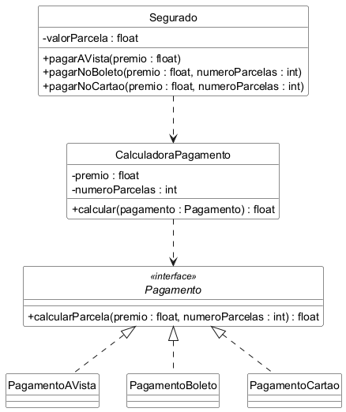

# Strategy

Trabalho da disciplina Aspectos Avançados em Engenharia de Software.

Exemplo do padrão Strategy em Java, com testes em JUnit 5. O tema é o mesmo da
seguradora usada nos trabalhos anteriores: o segurado escolhe como vai pagar o
prêmio do seguro, e cada forma de pagamento calcula a parcela de um jeito.

- À vista: 10% de desconto
- Boleto: dividido nas parcelas, sem juros
- Cartão: 10% de juros, dividido nas parcelas

Cada forma de pagamento é uma classe que implementa a interface `Pagamento`. A
`CalculadoraPagamento` recebe a forma escolhida e só chama o cálculo dela, sem
precisar saber qual é. Para criar uma forma nova de pagamento basta criar outra
classe, sem mexer nas que já existem.

## Diagrama de classes

